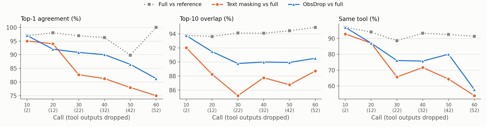

# ObsDrop

**KV-level observation dropping for official SGLang and official vLLM**

## Paper

**[Break Later or Never: Prefix-Preserving Context Compaction for Coding Agents](https://musacim.github.io/papers/papers/break-later-or-never-obsdrop.pdf)**

```bibtex
@misc{cim2026break,
  title = {{Break Later or Never: Prefix-Preserving Context Compaction for Coding Agents}},
  author = {Musa Cim and Burak Topcu and Mahmut Taylan Kandemir},
  year = {2026},
  note = {Preprint},
  doi = {10.6084/m9.figshare.34791231},
  url = {https://musacim.github.io/papers/papers/break-later-or-never-obsdrop.html}
}
```

## Overview

Coding agents resend their whole history on every model call, and most of it is old tool
output. Editing the prompt to remove it (masking, summarization) breaks prefix-cache reuse,
so the next call recomputes everything after the edit. ObsDrop removes old observations
from the **KV cache** instead of the prompt: after each turn, the KV of all tool outputs
except the newest K is freed, while the prompt stays append-only. The next call still
matches the full cached prefix, prefills only the new turn, and attends to fewer tokens.

ObsDrop is an extension of the official engines, not a fork: a small patch on an official
SGLang release, and a plugin for an unmodified official vLLM release.

| Engine | Official release | How ObsDrop is added | Folder |
|---|---|---|---|
| SGLang | `v0.5.3rc0` | patch to the radix cache | [`sglang/`](sglang/) |
| vLLM | `v0.27.1` | plugin (`pip install`), no vLLM file edited | [`vllm/`](vllm/) |

## SGLang

ObsDrop runs inside SGLang's radix cache (patch against `v0.5.3rc0`, commit `86a32bb`).

```bash
git clone https://github.com/sgl-project/sglang.git && cd sglang
git checkout v0.5.3rc0
git apply /path/to/ObsDrop/sglang/sglang.patch
pip install -e python
MODEL=/path/to/Qwen3-Coder-30B-A3B-Instruct OBS_K=8 bash /path/to/ObsDrop/sglang/launch_obsdrop.sh
```

`OBS_K` is the window (unset = no dropping); `launch_obsdrop.sh` sets the paper's server flags.
Observation delimiters default to Qwen3's `<tool_response>` tokens; for other models set
`SGLANG_OBS_MARKERS` (open,close token ids) and `SGLANG_OBS_PH` (placeholder token ids),
e.g. Devstral's `[TOOL_RESULTS]` = `7,8`.

## vLLM

ObsDrop runs as a plugin for the official vLLM `v0.27.1` release; no vLLM file is edited.

```bash
pip install vllm==0.27.1
pip install /path/to/ObsDrop/vllm
MODEL=/path/to/Qwen3-Coder-30B-A3B-Instruct OBS_K=8 bash /path/to/ObsDrop/vllm/launch_obsdrop.sh
```

`OBS_K` is the window (unset = no dropping). Observation delimiters default to Qwen3's
`<tool_response>` tokens; for other models set `MARKERS` (open,close token ids), e.g. Devstral's
`[TOOL_RESULTS]` = `7,8`. Serve with `--disable-cascade-attn` (set by `launch_obsdrop.sh`).

## Serving throughput

Qwen3-Coder-30B-A3B on 4x A100-40GB (tensor parallel 4),
replaying recorded SWE-bench Verified agent trajectories with 16 concurrent agents.

| Engine | Arm | Gen tok/s | TTFT p50 | E2E p90 | Prefix hit | Live KV per call |
|---|---|---|---|---|---|---|
| vLLM | No Compact | 157 | 3.51 s | 55.2 s | 42.3% | 33.1K |
| vLLM | ObsDrop K=8 | 594 ($\color{#00c853}{\large\textbf{+279\\%}}$) | 0.15 s ($\color{#00c853}{\large\textbf{-96\\%}}$) | 14.8 s ($\color{#00c853}{\large\textbf{-73\\%}}$) | 97.4% | 23.4K ($\color{#00c853}{\large\textbf{-29\\%}}$) |
| SGLang | No Compact | 184 | 2.73 s | 48.0 s | 43.0% | 33.3K |
| SGLang | ObsDrop K=8 | 610 ($\color{#00c853}{\large\textbf{+232\\%}}$) | 0.11 s ($\color{#00c853}{\large\textbf{-96\\%}}$) | 14.3 s ($\color{#00c853}{\large\textbf{-70\\%}}$) | 97.4% | 23.4K ($\color{#00c853}{\large\textbf{-30\\%}}$) |

## Accuracy

Mean ± std over 3 reps; Live KV is the mean KV one model call holds.

**Qwen3-Coder-30B-A3B on SWE-bench Verified, 200 tasks, 3 reps**

| Arm | Solved | Steps | Prefix hit | Live KV (mean) |
|---|---|---|---|---|
| No Compact | 46.7 ± 0.3% | 53.9 | 98.0% | 34.6K |
| ObsDrop K=8 | 46.8 ± 1.8% | 57.1 | 98.1% | 24.1K (−30.4%) |
| ObsDrop K=16 | 48.7 ± 2.6% | 54.6 | 98.0% | 26.9K (−22.3%) |

**Qwen3-Coder-30B-A3B on SWE-bench Multilingual, 200 tasks, 3 reps**

| Arm | Solved | Steps | Prefix hit | Live KV (mean) |
|---|---|---|---|---|
| No Compact | 28.0 ± 0.5% | 62.0 | 97.6% | 43.7K |
| ObsDrop K=8 | 27.5 ± 2.1% | 66.4 | 98.3% | 26.5K (−39.4%) |
| ObsDrop K=16 | 28.7 ± 1.7% | 63.5 | 98.2% | 30.2K (−30.8%) |

**gpt-oss-20b on BrowseComp-Plus, 200 tasks, 3 reps, Qwen3-30B judge**

| Arm | Solved | Rounds | Prefix hit | Live KV (mean) |
|---|---|---|---|---|
| No Compact | 64.5 ± 1.3% | 53.1 | 97.4% | 36.8K |
| ObsDrop K=8 | 65.5 ± 4.4% | 56.7 | 97.6% | 14.9K (−59.5%) |
| ObsDrop K=16 | 64.3 ± 1.6% | 53.0 | 97.4% | 20.1K (−45.4%) |

## Semantic equivalence

How close is the model's next step to the full context when old tool outputs are removed? Qwen3-Coder-30B-A3B on
SGLang, 100 recorded SWE-bench Verified trajectories, greedy decoding. At call *c* the oldest *c* − 8 tool outputs are
removed, either from the prompt text (text masking) or from the KV cache (ObsDrop K=8). Full vs reference is the same
full prompt reached by a different numeric path, the noise floor when nothing is removed.



ObsDrop stays closer to the full context than text masking.
